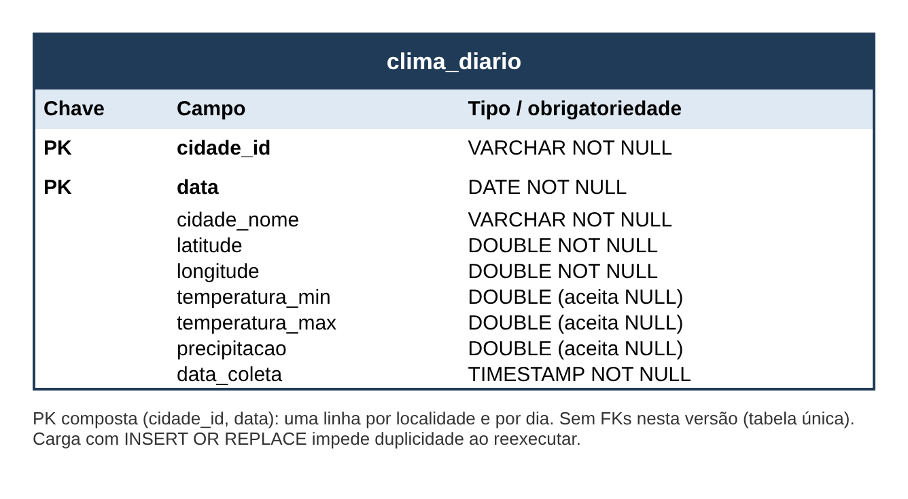
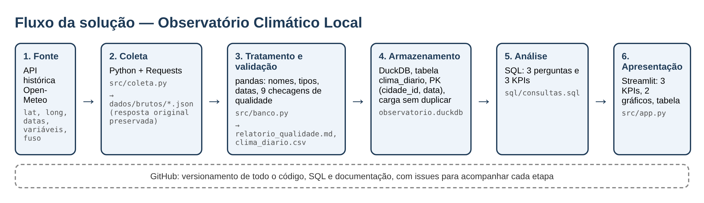
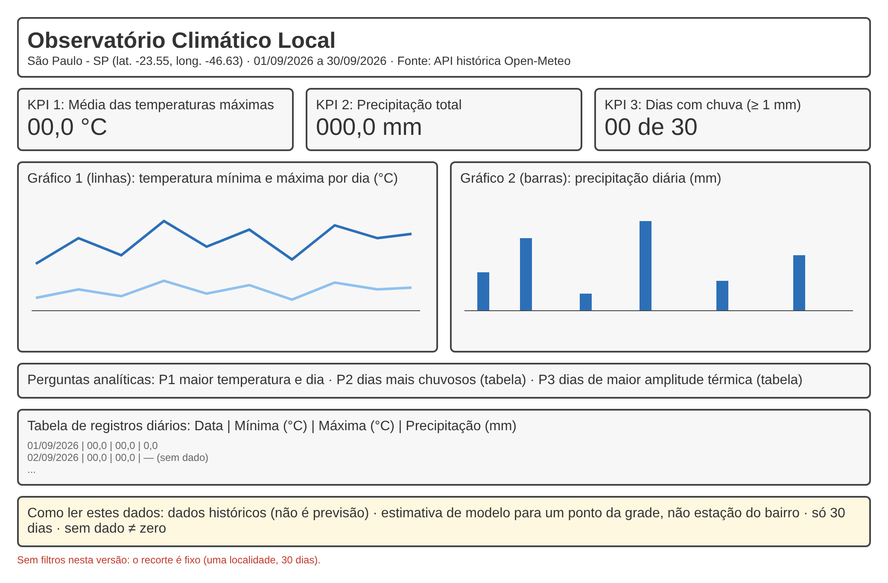

# Contexto e recorte

Este documento apresenta o desenho técnico do Observatório Climático Local antes da implementação, mantendo o problema, o público e as perguntas definidos na AE1.

- **Público beneficiário:** comunidade escolar (estudantes, professores de Educação Física e coordenação) de uma escola pública de São Paulo.
- **Necessidade:** planejar atividades ao ar livre (aulas de Educação Física, recreio, eventos) entendendo como foram o calor, as variações de temperatura e a chuva em um mês típico.
- **Localidade:** São Paulo - SP, latitude -23,55 e longitude -46,63.
- **Período:** 01/09/2026 a 30/09/2026 (30 dias consecutivos).
- **Variáveis (3):** temperatura mínima diária, temperatura máxima diária e precipitação diária acumulada.
- **Ferramentas:** API histórica Open-Meteo, Python e Requests, pandas, DuckDB e SQL, Streamlit e GitHub.

**Ajustes em relação à AE1:** [descrever aqui, se houver. Exemplo: a umidade foi substituída pela temperatura mínima para permitir a análise de amplitude térmica e a checagem "mínima não superior à máxima".]

# 1. Dicionário de dados (versão 1)

Tabela principal: `clima_diario`. Cada linha representa uma localidade em uma data.

| Campo | Tipo esperado | Descrição | Origem | Regra de preenchimento/validação |
|---|---|---|---|---|
| cidade_id | VARCHAR | Identificador da localidade, sem acentos nem espaços (ex.: `sao_paulo_sp`) | Configuração do projeto (`config.py`) | Obrigatório; texto em minúsculas; mesmo valor em todos os registros da localidade; parte da PK |
| cidade_nome | VARCHAR | Nome da localidade para exibição (ex.: "São Paulo - SP") | Configuração do projeto | Obrigatório; não pode ser vazio |
| latitude | DOUBLE | Latitude do ponto da grade usado pela API, em graus decimais | Campo `latitude` da resposta da API | Obrigatório; entre -90 e 90; próximo da coordenada configurada |
| longitude | DOUBLE | Longitude do ponto da grade usado pela API, em graus decimais | Campo `longitude` da resposta da API | Obrigatório; entre -180 e 180; próximo da coordenada configurada |
| data | DATE | Data correspondente ao registro diário (formato AAAA-MM-DD, fuso America/Sao_Paulo) | Campo `daily.time` da resposta da API | Obrigatório; data válida; deve pertencer ao período 01/09/2026 a 30/09/2026; parte da PK |
| temperatura_min | DOUBLE | Temperatura mínima do dia, a 2 m do solo, em °C | Campo `daily.temperature_2m_min` | Pode ser NULL se a API não informar; se presente, numérico entre -5 e 45 °C e menor ou igual a `temperatura_max` |
| temperatura_max | DOUBLE | Temperatura máxima do dia, a 2 m do solo, em °C | Campo `daily.temperature_2m_max` | Pode ser NULL; se presente, numérico entre -5 e 45 °C e maior ou igual a `temperatura_min` |
| precipitacao | DOUBLE | Precipitação acumulada no dia (chuva, garoa, neve), em mm | Campo `daily.precipitation_sum` | Pode ser NULL; se presente, numérico, maior ou igual a 0 e até 200 mm; ausência **não** é convertida em zero |
| data_coleta | TIMESTAMP | Data e hora em que a coleta foi feita | Gerado pelo `coleta.py` no momento da requisição | Obrigatório; não pode ser posterior à data da carga |

Valores calculados nas análises (não armazenados): `amplitude_termica = temperatura_max - temperatura_min` (°C) e `dia_com_chuva = precipitacao >= 1 mm`.

# 2. Modelo lógico (versão 1)

{width=60%}

| Item | Definição |
|---|---|
| Tabela principal | `clima_diario` |
| Chave primária | Composta: (`cidade_id`, `data`) |
| Campos obrigatórios (NOT NULL) | `cidade_id`, `cidade_nome`, `latitude`, `longitude`, `data`, `data_coleta` |
| Campos que aceitam ausência | `temperatura_min`, `temperatura_max`, `precipitacao` (ausência registrada como NULL) |
| Chaves estrangeiras | Não existem chaves estrangeiras nem relacionamentos nesta versão, pois há uma única tabela |
| Regra contra duplicidade | A PK impede duas linhas com a mesma localidade e data. A carga usa `INSERT OR REPLACE`, então rodar o processo de novo substitui os registros em vez de duplicá-los |

Estrutura prevista em SQL:

```sql
CREATE TABLE IF NOT EXISTS clima_diario (
    cidade_id        VARCHAR   NOT NULL,
    cidade_nome      VARCHAR   NOT NULL,
    latitude         DOUBLE    NOT NULL,
    longitude        DOUBLE    NOT NULL,
    data             DATE      NOT NULL,
    temperatura_min  DOUBLE,
    temperatura_max  DOUBLE,
    precipitacao     DOUBLE,
    data_coleta      TIMESTAMP NOT NULL,
    PRIMARY KEY (cidade_id, data)
);
```

## Fluxo da solução



# 3. Plano de qualidade dos dados

As checagens rodam no pandas antes da carga. Falhas **críticas** cancelam a carga; **alertas** são registrados e comunicados, mas não impedem a carga. O resultado de cada execução fica em `dados/processados/relatorio_qualidade.md`.

| # | Checagem | Campo(s) | Regra ou teste | Ação em caso de falha |
|---|---|---|---|---|
| 1 | Duplicidade | cidade_id, data | Não pode haver mais de um registro para a mesma combinação (`df.duplicated`) | Crítica: investigar a origem e resolver a duplicidade antes da carga |
| 2 | Campos obrigatórios | cidade_id, data | Não podem estar vazios | Crítica: corrigir a configuração ou a origem; impedir a carga do registro |
| 3 | Datas válidas e no recorte | data | Data convertida sem erro e entre 01/09/2026 e 30/09/2026 | Crítica: conferir os parâmetros `start_date` e `end_date` e coletar de novo |
| 4 | Cobertura do período | data | Exatamente 30 datas distintas, sem dias faltando | Crítica: listar os dias faltantes e repetir a coleta |
| 5 | Ausências nas variáveis | temperatura_min, temperatura_max, precipitacao | Contar valores nulos por variável | Alerta: manter como NULL (nunca trocar por zero), excluir do cálculo dos KPIs e informar no painel quantos dias ficaram sem dado |
| 6 | Mínima não superior à máxima | temperatura_min, temperatura_max | `temperatura_min <= temperatura_max` em todos os dias com os dois valores | Crítica: inspecionar o JSON original e verificar se as colunas foram trocadas |
| 7 | Precipitação não negativa | precipitacao | `precipitacao >= 0` | Crítica: conferir o JSON original; não carregar até corrigir |
| 8 | Unidades e tipos compatíveis | todas as variáveis | `daily_units` da API igual a °C, °C e mm; colunas numéricas após `pd.to_numeric` | Crítica: ajustar a conversão de unidades ou os parâmetros da requisição |
| 9 | Faixas plausíveis | temperaturas, precipitacao | Temperaturas entre -5 e 45 °C; precipitação até 200 mm/dia | Alerta: revisar manualmente o valor e registrar a decisão no relatório |

Justificativa das faixas: em São Paulo, a menor temperatura registrada fica perto de -2 °C e a maior perto de 38 °C, então -5 a 45 °C dá margem sem aceitar valores absurdos. Chuvas diárias acima de 200 mm são extremamente raras na cidade.

**Ausência não é zero:** um dia sem dado de precipitação fica NULL e aparece como "sem dado" na tabela. Um dia com `precipitacao = 0` significa que a fonte informou ausência de chuva.

# 4. Plano de análise e produto final

## 4.1 Relação entre perguntas, indicadores e visuais

| Pergunta analítica | Campos necessários | Cálculo/consulta planejada | Indicador e unidade | Gráfico ou tabela | Utilidade para o público-alvo |
|---|---|---|---|---|---|
| P1. Qual foi a maior temperatura do período e em qual dia? | data, temperatura_max | `ORDER BY temperatura_max DESC LIMIT 1` | KPI 1: média das máximas (°C) | Gráfico 1 (linhas) | Mostrar os dias mais quentes, que pedem hidratação e atividades na sombra |
| P2. Quais foram os dias mais chuvosos? | data, precipitacao | Filtro `precipitacao >= 1`, ordenado e limitado a 5 | KPI 2: precipitação total (mm); KPI 3: dias com chuva (dias) | Gráfico 2 (barras) e tabela dos 5 dias | Avaliar com que frequência a chuva impediria atividades ao ar livre |
| P3. Quais dias tiveram a maior diferença entre mínima e máxima? | data, temperatura_min, temperatura_max | `temperatura_max - temperatura_min`, ordenado de forma decrescente | Amplitude térmica média (°C), complementar | Gráfico 1 (distância entre as linhas) e tabela | Orientar sobre roupas em camadas em dias de manhã fria e tarde quente |

Também haverá uma **tabela com os 30 registros diários** (data, mínima, máxima, precipitação) para consulta.

**Definição dos indicadores**

| Indicador | Definição | Forma de cálculo | Unidade | Valores ausentes | Interpretação esperada |
|---|---|---|---|---|---|
| KPI 1: Média das temperaturas máximas | Temperatura máxima típica do período | `AVG(temperatura_max)` | °C | Dias sem dado são ignorados; o painel informa quantos foram | Indica o quanto as tardes foram quentes no mês |
| KPI 2: Precipitação total | Chuva acumulada no período | `SUM(precipitacao)` | mm | Dias sem dado são ignorados e informados; o total é então um valor mínimo | Indica se o mês foi mais seco ou mais chuvoso |
| KPI 3: Dias com chuva | Quantidade de dias com pelo menos 1 mm | `COUNT(*) FILTER (WHERE precipitacao >= 1)` | dias (de 30) | Dias sem dado não entram na contagem e são informados | Indica a frequência de dias em que a chuva pode afetar atividades externas |

O limiar de 1 mm é uma convenção usual para "dia de chuva" e evita contar garoas muito fracas. As análises dirão o que aconteceu no período, sem antecipar conclusões: os valores só serão interpretados depois da coleta.

## 4.2 Wireframe do dashboard



O painel terá título, localidade e período, fonte e unidades, três indicadores, dois gráficos, as respostas às perguntas, a tabela de registros e um quadro "Como ler estes dados" com as limitações. Não haverá filtros nesta versão, porque o recorte é fixo (uma localidade, 30 dias).

## 4.3 Comunicação extensionista

- **Como o painel responde à necessidade:** mostra, de forma visual, quantos dias foram quentes, chuvosos ou com grande variação de temperatura, ajudando a escola a pensar em horários e alternativas para atividades ao ar livre.
- **Como os resultados serão explicados:** em uma apresentação curta para professores e estudantes, com linguagem simples ("dia com chuva" em vez de "precipitação ≥ 1 mm"), mostrando primeiro os três números principais e depois os gráficos, e abrindo espaço para perguntas e feedback.
- **Limitações a comunicar:** os dados são históricos e não são previsão; vêm de modelos e reanálises da Open-Meteo para um ponto da grade, não de uma estação instalada na escola; 30 dias não permitem falar em tendência climática; dias sem dado não são zero.
- **Como evitar conclusões não sustentadas:** apresentar apenas o que os dados do período mostram, sem generalizar para outros meses ou anos; não fazer recomendações de saúde ou segurança, e sim sugerir que a escola consulte a previsão oficial e a Defesa Civil para decisões do dia a dia.

# 5. Atualização do GitHub

Repositório: [inserir link]

Estrutura de pastas:

```
projeto/
├── README.md
├── requirements.txt
├── .gitignore
├── dados/
│   ├── brutos/          # JSON original da API
│   └── processados/     # CSV tratado, banco DuckDB, relatórios
├── src/
│   ├── config.py
│   ├── coleta.py
│   ├── banco.py
│   └── app.py
├── sql/
│   └── consultas.sql
└── docs/
    └── escopo-1/
        ├── AE2/          # relatório técnico da implementação
        └── AE2-2/        # este documento, diagramas e wireframe
```

Issues criadas para orientar a implementação (detalhes em `docs/escopo-1/AE2-2/issues.md`):

| # | Issue | Critério de conclusão | Responsável |
|---|---|---|---|
| 1 | Implementar a coleta pela API | `coleta.py` busca os 30 dias com as 3 variáveis e o fuso correto | Paulo |
| 2 | Preservar a resposta original em JSON | JSON salvo em `dados/brutos/` com parâmetros e data da coleta | Paulo |
| 3 | Implementar o tratamento e as checagens de qualidade | As 9 checagens rodam e geram `relatorio_qualidade.md` | Paulo |
| 4 | Criar a tabela e a carga no DuckDB | Tabela com PK; rodar duas vezes mantém 30 registros | Paulo |
| 5 | Implementar as consultas e os indicadores | `consultas.sql` responde às 3 perguntas e calcula os 3 KPIs | Paulo |
| 6 | Construir o dashboard em Streamlit | Painel conforme o wireframe, rodando com `streamlit run` | Paulo |
| 7 | Revisar a documentação e preparar a devolutiva | README completo e roteiro da apresentação pronto | Paulo |

**Estágio atual:** desenho da solução concluído; implementação acompanhada pelas issues acima.
